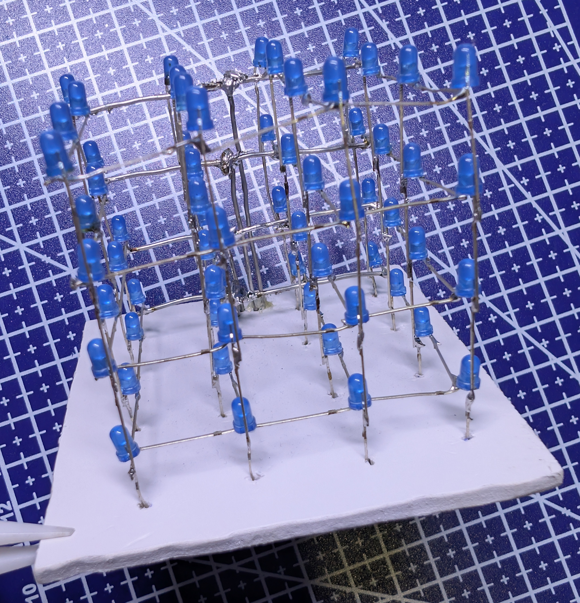
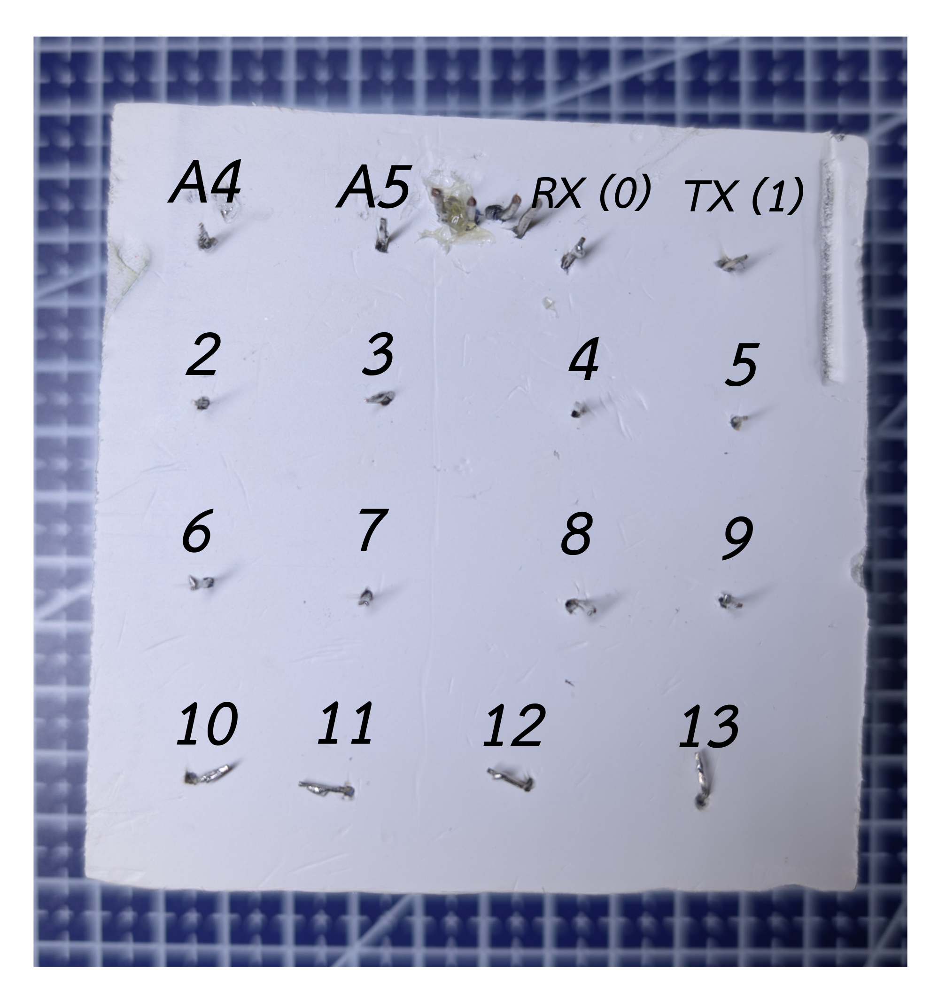
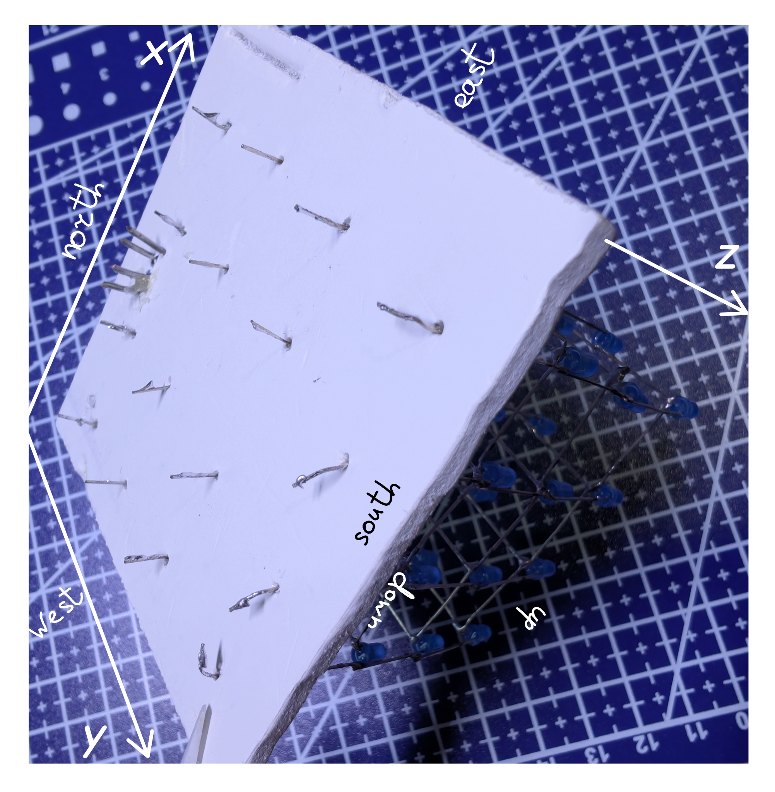

# Куб из светодиодов 4 × 4 × 4
Куб из светодиодов с кнопкой для переключения режимов (короткое нажатие - вперёд, длинное - назад). Отличный проект для изучения С++, embedded-разработки и прокачивания навыка пайки.

## Содержание
- [Необходимые материалы](#вам-потребуются)
- [Схема и сборка](#схема-и-сборка-проекта)
- [Описание окружения и структуры проекта](#описание-окружения-и-структуры-проекта)

## Вам потребуются

- **64 светодиода**
- **arduino nano** (в данном проекте использовалась с чипом ATmega328P) или любая другая плата с нужным количеством пинов (но тогда нужно менять конфиги)
- **кнопка**
- **резисторы** 1 штука на **10 кОм** и 4 штуки на **100 Ом**
- **провода**
- **проволока** для соединения слоёв с резисторами (опционально, можно заменить проводами, но не так красиво будет)

## Схема и сборка проекта

  <table>
    <tr>
      <td align="center">
         
        
          Куб 4×4×4. 
          Аноды светодиодов соединяются горизонтально в плоскости слоёв, а катоды вертикально соединяют столбцы.
        
      </td>
      <td align="center" style="padding-left: 20px;">
         
        
          Справа через резисторы подключение для слоёв, а «лапша» слева для столбцов.
        
      </td>
    </tr>
  </table>

#### Подключение пинов:
- **A0 - A3** - по порядку с первого слоя по четвёртый
- столбцы как на картинке ниже
- кнопка **A6**

> [!NOTE]
> Пины можно подключать и в другом порядке/к другим платам, но тогда необходимо их правильно указать в *config.h* для корректной работы прошивки. Кнопка подключается к аналоговому пину. Если её подключать к цифровому, то надо немного отредактировать модуль *button.h*

<!-- 

 -->

  <figure style="display: inline-block; text-align: center; margin: 0;">
    
    <figcaption style="margin-top: 6px;">
      Изображено как напрвлена координатная ось и направления движения в режиме <b><i>FlyingCube</i></b> при вышеуказанном подключение пинов
    </figcaption>
  </figure>

 
 

> [!CAUTION]
> Аноды (+, как правило длинная нога) светодиодов - это слои куба, катоды (-, как правило короткая нога) - столбцы. То есть отгибаем длинную ногу у каждого светодиода, соединяя слои, а короткая нога остаётся вертикально, соединяя столбцы. Таким образом, чтобы подав сигнал **HIGH** на четыре пина, к которым подключены через резисторы каждый из слоёв и подав сигнал **LOW** на 16 пинов к котрым подключены столбцы все светодиоды зажглись.

## Описание окружения и структуры проекта
В проекте использовалось расширение *platformio* (можно удобно установить в *VSCode*) и единственная сторонняя библиотека *Arduino.h* .

Новые режимы можно создавать в *lighting_modes* (.h и .cpp) наследуясь от класса **Mode** аналогично уже созданным и незабывая добавлять их ссылки на объекты в список режимов в *main.cpp* .

Режимы писались так, чтобы размеры куба можно было изменить без последствий, однако тестировался код только на кубе 4 × 4 × 4.

